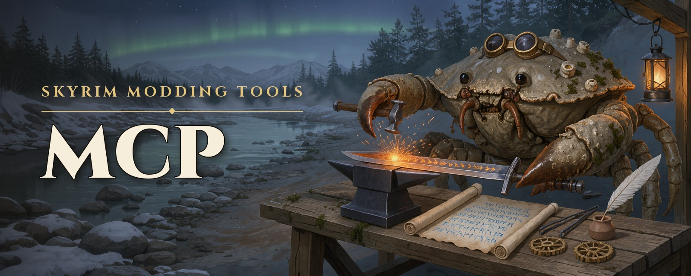

<p align="center">
  
</p>

<p align="center">
  <a href="https://github.com/Ciltress/skyrim-modding-tools-mcp/actions/workflows/ci.yml"></a>
  <a href="LICENSE"></a>
  
  
</p>

# skyrim-modding-tools-mcp

**Mod Skyrim Special Edition by talking to your AI agent.** This MCP server gives Claude Code, Claude Desktop,
VS Code — any MCP client — the tools to look into your whole load order, make mods and patches, install mods from
Nexus Mods and read your crash logs. It works with Mod Organizer 2 on Windows and Amethyst Mod Manager on Linux.

Ask it things like:

> *Make me a sword called Flame Blade that sets enemies on fire.*
>
> *Which mods change the Iron Sword, and which one wins?*
>
> *Make a patch that makes the Iron Sword a bit stronger.*
>
> *My game just crashed. Why?*

A mod is made as text: one YAML file per record, in a project you can keep in git, built into a real plugin and
deployed into your mod manager. The Creation Kit stays for what only it can do, like placing objects and navmesh;
its work is pulled back into the text. Plugins are read and written by
[Mutagen](https://github.com/Mutagen-Modding/Mutagen); the text is [Spriggit](https://github.com/Mutagen-Modding/Spriggit)'s
format.

## What it offers

**🔍 Look things up**

| Tool | Does |
| --- | --- |
| `findRecords` | Search the active load order by name or editor ID; resolve FormIDs to names and back |
| `readRecord` | One record as project text — the winning version, one plugin's, or every version side by side |

**✍️ Make mods and patches**

| Tool | Does |
| --- | --- |
| `newProject` | Start a new mod |
| `addPatch` | Copy existing records into a patch as overrides, from their winning version, to change them without touching the original mod |
| `editRecord` | Change a record file's fields by their paths, with no old text to match |
| `moveRecord`, `deleteRecord` | Put a record file where the build reads it, or remove one the mod no longer needs |
| `buildProject` | Text → plugin: assigns FormIDs to new records, checks every reference, compiles Papyrus scripts, and lists what the plugin holds |
| `deployProject` | Build → mod manager: mod folder, enabled, plugin at the end of the load order |
| `pullProject` | Changes made in the Creation Kit or xEdit → back into the text |

**📦 Find and install mods**

| Tool | Does |
| --- | --- |
| `searchNexus` | Find Skyrim SE mods on Nexus Mods by name, or list the most endorsed, downloaded or updated — with an API key |
| `readNexusMod` | One Nexus mod page: description, requirements (SKSE, other mods, DLC), the files it offers — with an API key |
| `downloadNexusFile` | A file of a Nexus mod into the instance's downloads folder — with a premium account's API key |
| `installMod` | A downloaded file → a mod: unpacked, its FOMOD installer answered, enabled, its plugins active |
| `enableMod`, `disableMod` | A mod enabled or disabled, on the user's word — and which plugins now miss a master |
| `listMods` | The mods installed, in priority order: enabled or not, their plugins, their Nexus record, whether they carry SKSE plugins |

**💥 Keep the game running**

| Tool | Does |
| --- | --- |
| `readCrashLog` | Why the game crashed, from Crash Logger SSE's log: known crashes with their fixes, and the mods behind what the log names |
| `checkGameVersion` | Whether SKSE, Address Library and each SKSE plugin fit the game version |
| `editIni` | Settings of Skyrim.ini, SkyrimPrefs.ini or SkyrimCustom.ini, on the user's word |

**📚 Know how**

`readSkill` serves the modding skills — how plugins, FormIDs, load order and conflicts work, the community's tools,
and one skill each for items and crafting, magic, NPCs, leveled lists, game updates and crash analysis.
`readServerGuide` serves the server's own guides, and `healthcheck` says what the server is bound to.

## Requirements

- **Skyrim Special Edition** 1.5.97 to 1.7.x, managed by **Mod Organizer 2** (2.5) on Windows, or
  **Amethyst Mod Manager** (2.5) on Linux. Mod Organizer under Proton is experimental
  ([`docs/Hosting.md`](docs/Hosting.md) §5).
- **Node.js 24** and **git**. `npm run setup` brings the rest: the .NET 10 SDK, and on Linux a Papyrus
  compiler.
- Optional: **Git LFS**, if you keep your projects in git and they hold meshes or textures — the
  projects folder's `.gitattributes` sends those to it once it is installed. Without it, git keeps them
  as ordinary files.
- For compiling Papyrus scripts (optional otherwise): the **Creation Kit** (free on Steam) for its
  vanilla script sources; on Windows its compiler needs **.NET Framework 3.5** (Windows Features).

## Setup

**Windows**, in PowerShell — the first two lines only for what you do not have yet, then open a new
PowerShell:

```powershell
winget install --exact --id OpenJS.NodeJS.LTS
winget install --exact --id Git.Git
git clone https://github.com/Ciltress/skyrim-modding-tools-mcp
cd skyrim-modding-tools-mcp
npm run setup
```

**Linux** (CachyOS, Arch):

```bash
sudo pacman -S --needed nodejs npm git
git clone https://github.com/Ciltress/skyrim-modding-tools-mcp ~/skyrim-modding-tools-mcp
cd ~/skyrim-modding-tools-mcp
npm run setup
```

`npm run setup` installs the .NET 10 SDK if it is missing, builds the server and its
plugin helper, and finds your mod manager — it asks for the Mod Organizer instance only when it finds
none, and for your Nexus Mods API key if you want the Nexus tools. It registers the server with
Claude Code, Claude Desktop and VS Code, and ends with a healthcheck: the instance, profile and game
version it found. Everything it installs, downloads or registers, it asks about first.

**OpenClaw** gets the same tools from the
[OpenClaw plugin](https://github.com/Ciltress/skyrim-modding-tools-openclaw-plugin) instead, set up in OpenClaw's
own Settings; setup says so when it finds OpenClaw.

**Updating:** `git pull && npm run setup`, then restart your client. A client still running the server
keeps the plugin helper in use; setup then names what to close.

**By hand** instead — the settings file and each client's registration, ready to copy:
[`docs/Hosting.md`](docs/Hosting.md) §1.1.

**Work on a test instance.** Deploys write into the instance's mods and profile. A dedicated
portable Mod Organizer on a clean game is the safe place to learn the tools — and if your instance
was installed by Wabbajack, an update deletes every mod it did not install.

## Configuration

See [`.env.example`](.env.example). A path may start with `~` and use `$NAME` or `${NAME:-default}`, as
in a shell, on every system; a relative one is taken from the server's folder
([`docs/Hosting.md`](docs/Hosting.md) §1.1).

| Variable | Default | Effect |
| --- | --- | --- |
| `SKYRIM_MOD_MANAGER` | found by itself | `mo2` (Mod Organizer 2) or `amethyst` (Amethyst Mod Manager, Linux). Unset: Mod Organizer when `SKYRIM_MO2_INSTANCE` is set, else Amethyst when it has Skyrim set up |
| `SKYRIM_MO2_INSTANCE` | — (required with Mod Organizer) | The Mod Organizer instance folder; the server follows its selected profile |
| `SKYRIM_WINE_PREFIX` | found by itself for MO2-LINT | Mod Organizer under Proton: the Wine prefix it runs in, to read its ini's Windows paths |
| `SKYRIM_AMETHYST_DIR` | found by itself | Amethyst's config folder, if it is neither the Flatpak's nor `~/.config`'s |
| `NEXUS_API_KEY` | none | Your personal Nexus Mods API key; `healthcheck` shows its account. Without it the Nexus tools are not offered; `downloadNexusFile` is offered only when Nexus confirms a premium account |
| `SKYRIM_PROJECTS_DIR` | `./projects` | Where projects live |
| `SKYRIM_CK_DIR` | the instance's game folder | The Creation Kit, for its Papyrus compiler and vanilla script sources |
| `SKYRIM_PAPYRUS_COMPILER` | the Creation Kit's (Windows); on Linux `papyrus-compiler` on `PATH`, else `tools/papyrus-compiler/papyrus` beside the server or in your home folder | `PapyrusCompiler.exe`, or russo-2025's `papyrus-compiler`, which runs on Linux |
| `SKYRIM_CRASH_LOG_DIR` | `My Games\Skyrim Special Edition\SKSE` (under Proton, the prefix's) | Where `readCrashLog` reads Crash Logger SSE's `crash-*.log` files |
| `SKYRIM_HELPER_PATH` | the core's `helper/bin/SkyrimHelper(.exe)` | The built plugin helper |
| `MCP_PROFILE` | `all` | `core`, `readonly` or `all` — which tools are listed and callable |
| `MCP_MAX_RESPONSE_BYTES` | per profile | Ceiling on one answer; `0` removes it |
| `MCP_TRANSPORT` | `stdio` | `http` for Streamable HTTP at `/mcp` — see [`docs/Hosting.md`](docs/Hosting.md) |
| `SKYRIM_ACCEPTED_TOKENS` | none | HTTP mode: the bearer tokens callers may present |

## Documentation

The tools themselves — with their router, behaviour guide, skills and vocabulary — are
[skyrim-modding-tools-core](https://github.com/Ciltress/skyrim-modding-tools-core), which this server and its
OpenClaw plugin both serve. The core can also be used on its own, from your own program.

| Document | For |
| --- | --- |
| The core's [`docs/Tool-Router.md`](https://github.com/Ciltress/skyrim-modding-tools-core/blob/main/docs/Tool-Router.md) | Which tool does what, in the words people use |
| The core's [`docs/MCP-Tools.md`](https://github.com/Ciltress/skyrim-modding-tools-core/blob/main/docs/MCP-Tools.md) | How the server behaves: rules, architecture, workflows, errors, troubleshooting |
| [`docs/Tool-Reference.md`](docs/Tool-Reference.md) | Every tool and argument — generated, never edited by hand |
| The core's [`skills/`](https://github.com/Ciltress/skyrim-modding-tools-core/tree/main/skills) | The modding knowledge the server serves to agents |
| The core's [`CONTEXT.md`](https://github.com/Ciltress/skyrim-modding-tools-core/blob/main/CONTEXT.md) | The vocabulary |
| [`docs/Hosting.md`](docs/Hosting.md) | stdio and Streamable HTTP |
| [`AGENTS.md`](AGENTS.md) | Working on this code |

The guides are served to clients too: ask the running server with `readServerGuide`.

## Development

```bash
npm run build:helper   # the core's plugin helper, built in its folder
npm run build          # tsc -> dist/
npm test               # vitest, fully offline: no game, no helper needed
npx tsc --noEmit       # type check only
npm run docs:tools     # regenerate docs/Tool-Reference.md after changing a tool (needs a build)
npm run smoke          # the built server over real stdio
```

## License and thanks

GPL-3.0 — see [`LICENSE`](LICENSE) — as [Mutagen](https://github.com/Mutagen-Modding/Mutagen), the plugin engine, is
GPL-3.0. The crash rules are Phostwood's [Skyrim Crash Log Analyzer](https://github.com/Phostwood/crash-analyzer)'s,
ported in the core. Copyright © 2026 Andreas Breit; co-authored with Claude (Anthropic).
